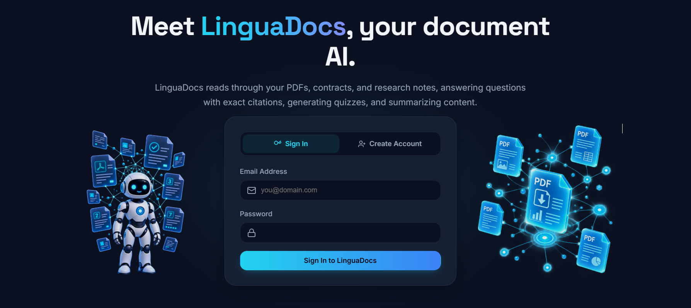
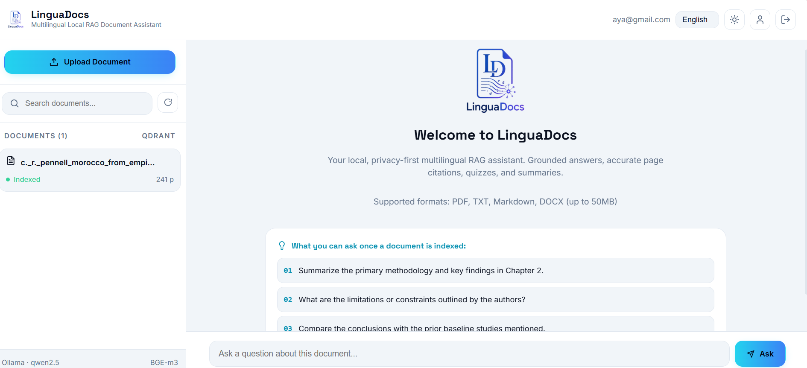
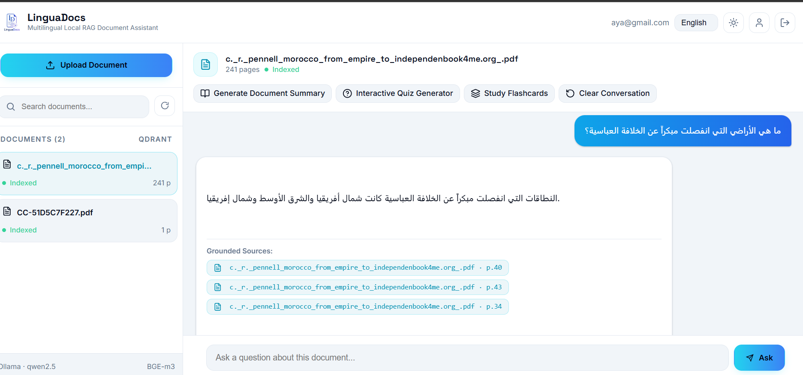

# LinguaDocs — Local Multilingual RAG Assistant





---

## Interface

| | |
|---|---|
|  | **Connexion** — inscription / connexion par email + mot de passe, interface en EN / FR / ES / AR, thème clair/sombre. |
|  | **Workspace** — documents importés à gauche, conversation à droite, viewer du document (chunks + pages) dans un panneau latéral. |
|  | **Réponse sourcée** — réponse dans la langue de la question, sources cliquables `[fichier, page]`, mise en page RTL pour l'arabe. |

---

## Projet

**LinguaDocs** est un assistant RAG multilingue, **100 % local** (CPU uniquement, rien ne sort de la machine).

- On dépose ses documents (PDF, TXT, MD, DOCX — 50 Mo max), on pose une question, on obtient une réponse **citée** (fichier + page) dans la langue de la question.
- L'isolation est stricte : chaque utilisateur ne voit que ses propres documents, à chaque couche du retrieval.
- 4 langues gérées de bout en bout : **EN · FR · ES · AR** (avec RTL).

| | |
|---|---|
| Backend | FastAPI · SQLModel · PostgreSQL 16 (SQLite en test) |
| Vecteurs | Qdrant — dense + BM25 sparse, fusion RRF, reranker cross-encoder |
| Embeddings | `BAAI/bge-m3` (1024 dims) |
| Reranker | `BAAI/bge-reranker-v2-m3`, top 3 chunks |
| LLM | Ollama `qwen2.5:3b-instruct` (local, streaming SSE) |
| UI | HTML / CSS / JS maison, sans Node ni React |

---

## Comment cloner

**Prérequis** : Python ≥ 3.11, [uv](https://docs.astral.sh/uv/), Docker, [Ollama](https://ollama.com/).

```bash
git clone https://github.com/Ayaa-ch/linguadocs.git
cd linguadocs

uv sync                        # installe les dépendances (pyproject.toml + uv.lock)

docker compose up -d           # Qdrant (:6333) + PostgreSQL (:5432)
ollama pull qwen2.5:3b-instruct

uv run uvicorn linguadocs.main:app --port 8000
```

| | |
|---|---|
| UI | http://localhost:8000 |
| API (Swagger) | http://127.0.0.1:8000/docs |
| Health check | http://127.0.0.1:8000/health |

Les variables d'environnement (base, Qdrant, Ollama, seuil de refus…) sont lues dans `src/linguadocs/settings.py` et surchargeables par un fichier `.env` à la racine.

---

## Comment tester

```bash
uv run pytest -q                 # 52 tests (SQLite en mémoire, LLM mocké) — ~2 min
```

Le harnais de mesure (latence, TTFT, débit) :

```bash
uv run python scripts/bench_latency.py     # breakdown ingest → retrieval → rerank → LLM
uv run python scripts/bench_ttft.py         # time to first token selon top_n
uv run python scripts/bench_num_predict.py  # débit vs num_predict
```

---

## C'est quoi / Comment ça marche

Un document déposé suit ce chemin :

```
PDF / TXT / MD / DOCX
   → parse (pdfplumber / python-docx)      src/linguadocs/ingest/parsers.py
   → normalisation Unicode + arabe          src/linguadocs/ingest/language.py
   → découpe en chunks de 200 mots (±40)   src/linguadocs/ingest/chunker.py
   → embeddings denses + BM25 sparse → Qdrant

Question
   → normalisation                          src/linguadocs/ingest/language.py
   → recherche hybride (dense + BM25, fusion RRF), filtre user_id obligatoire
   → reranker cross-encoder → 3 chunks      src/linguadocs/retrieval/retrieval.py
   → refus si le score dense est trop bas   src/linguadocs/api/routes_ask.py
   → prompt + LLM local (Ollama, SSE)       src/linguadocs/llm/
   → réponse + sources cliquables
```

Les points sensibles, en bref :

- **Isolation** — le `user_id` du JWT est ajouté à **chaque** requête Qdrant ; sans lui, aucune recherche n'est possible.
- **Reranker indisponible** — pas de repli silencieux sur le tri par score : `/ask` répond **503** avec un message explicite.
- **Refus** — seuil `REFUSAL_THRESHOLD` sur le score dense (k=3), pas sur le score RRF qui ne discrimine pas le hors-domaine.
- **Outils** — résumé / quiz / flashcards / traduction sont branchés sur `mocks.py` tant que le LLM n'est pas connecté.

---

## Coming soon

Quatre fonctions sont **mockées** (`mocks.py`) : elles simulent un délai pour exercer les états de chargement de l'interface. Chaque route renvoie `501` tant que le LLM n'est pas branché.

- Résumé de document
- Quiz
- Flashcards
- Traduction

---

## Évaluation

Le harnais d'évaluation (aligné sur le pipeline réel de l'app : mêmes chunking, mêmes paramètres, mêmes collections séparées) est en cours de finalisation et n'est pas encore publié.
